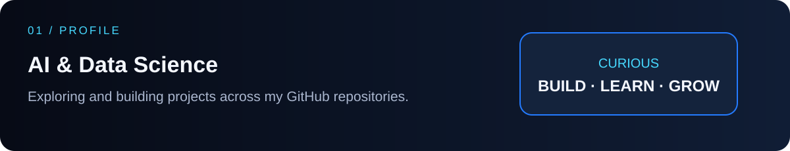
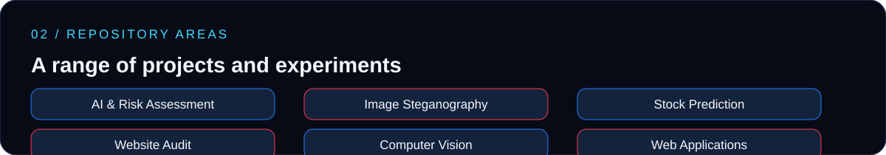
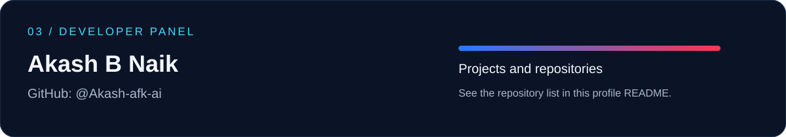

<!-- Profile README for Akash-afk-ai -->

  

  <a href="https://github.com/Akash-afk-ai">GitHub</a> ·
  <a href="https://www.linkedin.com/in/akash-b-naik-a3a12a33b/">LinkedIn</a> ·
  <a href="https://www.instagram.com/knocked__cell_">Instagram</a>

  

## Projects & repositories

### Public repositories

| Repository | Description |
|---|---|
| [bellcorp-parking-lot](https://github.com/Akash-afk-ai/bellcorp-parking-lot) | Parking management system. Its README describes a React/Vite frontend, Node.js/Express API, PostgreSQL, MongoDB and Redis. |
| [TRUST-](https://github.com/Akash-afk-ai/TRUST-) | Enterprise compliance and risk assessment platform; its README mentions OCR, knowledge graphs, fraud detection, risk scoring and Gemma AI. |
| [TRUSTAPP](https://github.com/Akash-afk-ai/TRUSTAPP) | Repository describing an AI-powered enterprise compliance and risk assessment platform. |
| [ImageSteganographySystem-1](https://github.com/Akash-afk-ai/ImageSteganographySystem-1) | Image steganography project. |
| [stock-prediction-1](https://github.com/Akash-afk-ai/stock-prediction-1) | Stock prediction project. |
| [Website-Audit-Tool-with-Security-and-Performance-Analysis](https://github.com/Akash-afk-ai/Website-Audit-Tool-with-Security-and-Performance-Analysis) | Website audit project focused on security and performance analysis. |
| [Retinal-vessel-segmentation-binary-vessel-vs-background-](https://github.com/Akash-afk-ai/Retinal-vessel-segmentation-binary-vessel-vs-background-) | Retinal vessel segmentation repository; the name specifies binary vessel-versus-background segmentation. |
| [my_protfolio](https://github.com/Akash-afk-ai/my_protfolio) | Personal portfolio repository. |
| [runanywhere-sdks](https://github.com/Akash-afk-ai/runanywhere-sdks) | RunAnywhere SDK repository. |
| [FIRST-FLASK](https://github.com/Akash-afk-ai/FIRST-FLASK) | Flask repository. |

### Private repositories

These are private, so only their names are displayed here.

- `stock-prediction`
- `spamguard-unmasked`
- `securevision-app`

  

  

  

Davanagere, Karnataka, India

